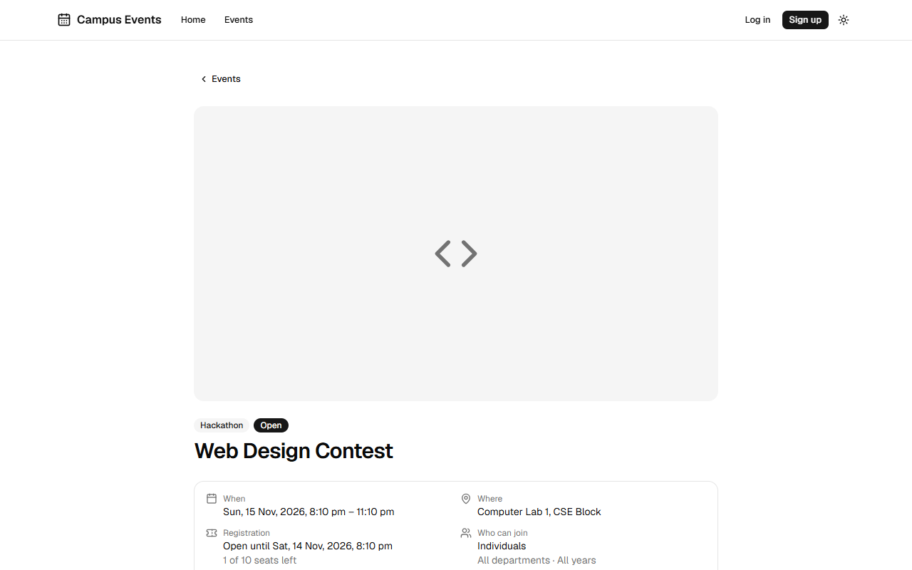
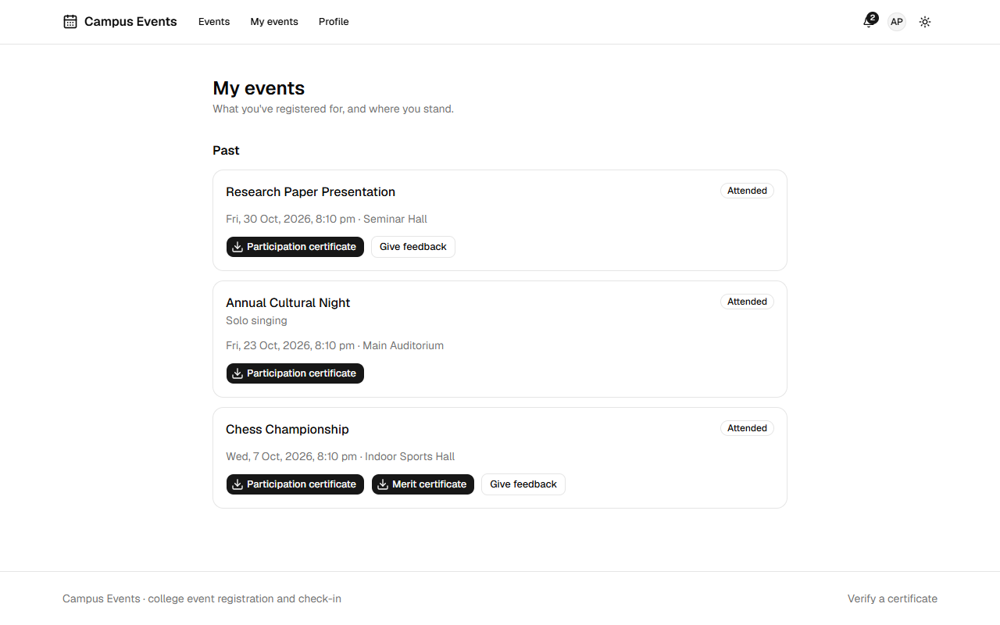
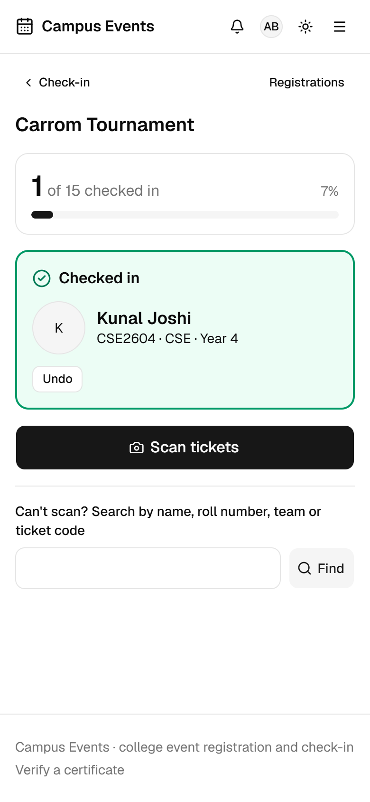
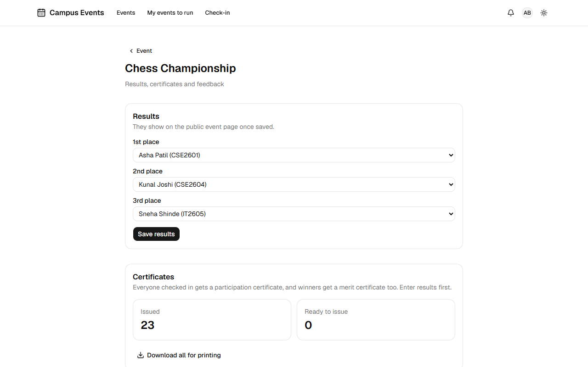
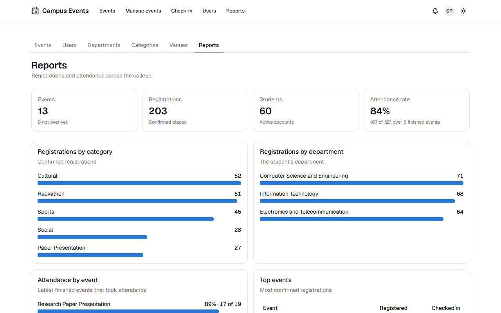

# CSMSS Events

College event management: students find events, register solo or as a team, and check in with a QR ticket; coordinators run their events; admins manage everything and see reports.

Final-year project. The full spec and the 12-week build plan live in the project spec doc. This repo is at **Phase 6 (hardening and submission)**: students sign up, register solo or as a team and get a QR ticket by email; coordinators scan it with a phone camera at the door, send announcements, enter results and issue PDF certificates that anyone can verify by QR; attendees leave feedback; admins see attendance across the college.

| Find an event                                                  | Your events and certificates                                               | At the door, on a phone                                                          |
| -------------------------------------------------------------- | -------------------------------------------------------------------------- | -------------------------------------------------------------------------------- |
|  |  |  |

| Coordinator's results and feedback            | College reports                               |
| --------------------------------------------- | --------------------------------------------- |
|  |  |

All names in these pictures are made up by the demo seed.

## Tech stack

| Layer          | Choice                                                            |
| -------------- | ----------------------------------------------------------------- |
| Framework      | Next.js 16 (App Router, Cache Components) + TypeScript            |
| UI             | Tailwind CSS 4, shadcn/ui (Base UI), lucide-react, light and dark |
| Database       | PostgreSQL 17 (Docker locally, Neon in production)                |
| ORM            | Prisma 7 with the `pg` driver adapter                             |
| Tests          | Vitest (unit, integration); Playwright with axe (end-to-end)      |
| CI and hosting | GitHub Actions; Vercel                                            |

## Run it locally

You need Node.js 24 and Docker Desktop. A fresh clone takes three commands:

```bash
docker compose up -d
npm run setup
npm run dev
```

`npm run setup` creates `.env` with its own secrets (an existing `.env` is left alone), installs packages, creates the tables and adds the master data and the demo college. Then open http://localhost:3000.

| Demo login  | Email                                 | Password             |
| ----------- | ------------------------------------- | -------------------- |
| Admin       | `admin@demo.campusevents.test`        | `demo-password-2026` |
| Coordinator | `coordinator1@demo.campusevents.test` | `demo-password-2026` |
| Student     | `student01@demo.campusevents.test`    | `demo-password-2026` |

Those passwords only exist on your own computer: the seed refuses a non-local database unless you set `ALLOW_DEMO_SEED=yes` and a `DEMO_PASSWORD` of your own. `.env` also holds a seed admin (`SEED_ADMIN_EMAIL`, `SEED_ADMIN_PASSWORD`) for real use.

Without `RESEND_API_KEY`, all emails are printed in the terminal running `npm run dev`; open the link from there.

## Demo

New here? [docs/TRY-IT-YOURSELF.md](docs/TRY-IT-YOURSELF.md) walks you through the whole app in about 30 minutes, as a student, a coordinator and an admin.

[docs/DEMO.md](docs/DEMO.md) is a 12-minute script for presenting it, with fallbacks. The demo college has 3 departments, 60 students, 3 coordinators and 15 events in every state: finished with results and certificates, happening now, open, one seat left, full with a waitlist, final-year only, not open yet, draft and cancelled. Dates are relative to when it runs, so refresh it within an hour or two of a demo with `npm run db:seed:demo`, which replaces the earlier demo data. The demo accounts use the reserved `.test` domain, so no email is ever sent to them.

## Logins and roles

| Role        | Gets                                                    | Can't open                      |
| ----------- | ------------------------------------------------------- | ------------------------------- |
| Visitor     | Home, sign up, log in                                   | `/profile`, `/manage/*` (login) |
| Student     | Profile, registration, teams, My events, QR ticket      | `/manage/*` (403)               |
| Coordinator | Their events: edit, registrations and exports, check-in | Admin pages (403)               |
| Admin       | Everything: users, master data, every event, reports    | —                               |

- Passwords are hashed with bcrypt; logins are Auth.js JWT cookies.
- Every page and server action calls `requireRole()` (`src/server/session.ts`), which re-reads the user from the database. `src/proxy.ts` adds a fast redirect or HTTP 403 from the cookie, using the rules in `src/lib/access.ts`.
- Changing a role, deactivating an account or resetting a password bumps `users.session_version`, which signs that user out everywhere.
- Email links (verify, reset) are single-use and stored only as SHA-256 hashes (`auth_tokens`).
- Google sign-in turns on when `AUTH_GOOGLE_ID`, `AUTH_GOOGLE_SECRET` and `ALLOWED_EMAIL_DOMAIN` are all set, and accepts only that domain.

## Security

**Rate limits** count in the `rate_limits` table, because each Vercel instance has its own memory, and one SQL statement reads and writes so a burst can't slip through. Keys are hashes, so the table holds no emails or addresses.

| What               | Limit                                | Why that size                                                               |
| ------------------ | ------------------------------------ | --------------------------------------------------------------------------- |
| Login              | 10 per 15 min, per email and address | Cleared on success. One locked login affects no one else                    |
| Login, per address | 300 per 15 min                       | A whole campus can share one Wi-Fi address                                  |
| Sign-up            | 60 per hour, per address             | Same; a launch day must not lock out the college                            |
| Reset link         | 3 per hour per email, 60 per address | A mailbox can't be flooded. The answer never changes, so it reveals nothing |
| Set a new password | 30 per hour, per address             | Tokens are unguessable; this only limits noise                              |
| Verification email | 5 per hour, per person               | Each one sends mail                                                         |
| Team invite        | 30 per hour, per person              | Each one emails someone else                                                |
| Upload             | 30 per hour, per person              | Protects the free Cloudinary quota                                          |

- The login limit sits inside Auth.js's `authorize`, not the form's action, because `/api/auth/callback/credentials` accepts logins directly.
- **Every route is role-checked on the server.** `tests/unit/route-guards.test.ts` fails the build if a new action, API route or protected page has no check, and `e2e/access.spec.ts` tries the routes as a visitor, a student, the wrong coordinator and an admin.
- **Uploads** must be a JPG, PNG, WebP or PDF under 3 MB, and the first bytes must match the type, so a renamed file is refused. Stored files get random names.
- **Headers** on every response stop other sites framing these pages, stop browsers guessing file types, keep reset tokens out of referrers and allow the camera only on this site. There's no full Content-Security-Policy, because script rules would need per-request nonces, which static pages can't have. Rich text is sanitised when saved instead, and a test checks that a script can't reach the public page.
- **Secrets** are only in `.env`, which git ignores, and a test checks `.env.example` holds no real values. Git history has never contained a `.env`.
- **Known warnings:** `npm audit` lists low and moderate issues in `deepmerge` and `minimatch`, reached through the shadcn CLI and the email renderer's text conversion. Neither receives anything a visitor types, and the only offered fix is a breaking downgrade, so they're left for now.

## Registration rules

- Every change that touches seats first locks the event's row (`SELECT … FOR UPDATE`, `src/server/services/registrations.ts`), so changes to one event happen one at a time. A test fires 50 parallel registrations at a 10-seat event and gets exactly 10 confirmed and 40 waitlisted.
- A team registers when enough members accept to reach the minimum size, and loses its place if it drops below it. Every member has their own registration row. "A seat is taken by" decides whether a team uses one seat or one per member.
- When a seat frees up, the waitlist is walked in order and each place that fits is promoted. A team too big for the seats left stays at the front while a smaller one behind it goes in.
- Registering, cancelling and team changes all end when registration closes. Once people have joined, an event can't switch between solo and team, change its team settings, or lower its limit below the seats taken.
- Rules that need no database live in `src/lib/registrations.ts`. The event page uses them to explain a disabled button and the service uses them to refuse the request.

## Tickets and check-in

- Each confirmed person gets their own ticket code, like `K7QM-3XRT-9PWA-HC2D`: 10 random characters and a 6-character signature made with `AUTH_SECRET` (`src/lib/tickets.ts`). It isn't a database id, and the same code works in the QR or typed by hand. Cancelling kills the code; registering again issues a new one.
- `/manage/check-in/<event>` reads QR codes with the phone camera (`jsqr` on camera frames) and shows name, photo, roll number, team and a live counter. Browsers only offer the camera on https or localhost, so phones need the deployed site; if the camera fails, search by name, roll number, team or ticket code works the same.
- A check-in only updates a confirmed registration not yet checked in, in one statement, so two phones scanning one ticket can't both succeed. A second scan says who let them in and when. Mistakes can be undone. Check-ins, undos and exports are all written to `audit_logs`.
- Check-in opens a day before an event starts and closes a day after it ends.
- Registrations can be filtered and exported as CSV or Excel, and an export holds exactly what the filters show. Ticket codes are never exported, and CSV cells that a spreadsheet would run as formulas are neutralised.
- The attendance rate on `/manage/reports` only counts finished events where at least one person was checked in. An event that never scanned anyone didn't take attendance, and counting it would read as everyone staying away.

### API

Errors look like `{ "error": { "code": "...", "message": "..." } }`, with status 401 when signed out and 403 for the wrong role. "Event staff" means admins and that event's coordinators. Under `/api/v1`:

| Method | Path                                                                                        | Who                | Purpose                                                     |
| ------ | ------------------------------------------------------------------------------------------- | ------------------ | ----------------------------------------------------------- |
| GET    | `/events/:id/checkin`                                                                       | Event staff        | Live counter: registered and checked in                     |
| POST   | `/events/:id/checkin`                                                                       | Event staff        | Check in; body `ticketCode` or `registrationId`             |
| DELETE | `/events/:id/checkin/:registrationId`                                                       | Event staff        | Undo a check-in                                             |
| GET    | `/events/:id/checkin/search?q=`                                                             | Event staff        | Find a confirmed person                                     |
| GET    | `/events/:id/registrations?format=json\|csv\|xlsx&q=&status=&attendance=&department=&year=` | Event staff        | List or export registrations                                |
| GET    | `/events/:id/certificates`                                                                  | Event staff        | All its certificates in one PDF; ?sample=MERIT for a sample |
| GET    | `/certificates/:id`                                                                         | Owner, event staff | One certificate as a PDF                                    |
| GET    | `/me/notifications`                                                                         | Signed in          | The bell: latest messages and unread count                  |
| POST   | `/me/notifications`                                                                         | Signed in          | Mark read; body `{ id }` or `{ all: true }`                 |

Outside `/api/v1`:

| Method | Path                         | Who                  | Purpose                                        |
| ------ | ---------------------------- | -------------------- | ---------------------------------------------- |
| GET    | `/events/:slug/calendar.ics` | Public               | Add to calendar; drafts answer 404             |
| GET    | `/certificates/verify?code=` | Public               | Verify page: name, team, event, dates and type |
| GET    | `/api/cron/event-status`     | `Bearer CRON_SECRET` | Daily: save status changes, clear old counters |
| GET    | `/api/cron/reminders`        | `Bearer CRON_SECRET` | Daily: remind people of events within 36 hours |
| \*     | `/api/auth/*`                | Public               | Auth.js: login, logout, session, CSRF          |

The spec's section 7 planned a REST route for everything. Forms use **server actions** instead, which are typed and get CSRF protection from Next.js. They're public endpoints all the same, so each checks the role itself:

| Spec route                                                 | Implemented as (`src/server/actions/`)                                   |
| ---------------------------------------------------------- | ------------------------------------------------------------------------ |
| `/auth/signup`, `login`, `logout`, `forgot`, `reset`       | `auth.ts`: `signupAction`, `loginAction`, `logoutAction`, ...            |
| `/me` (update)                                             | `profile.ts`: `updateProfileAction`                                      |
| `/events`, `/events/:id` (create, edit, status)            | `events.ts`: `saveEventAction`, `changeEventStatusAction`, ...           |
| `/events/:id/register`, `/teams`, `/teams/:id/invites`     | `registrations.ts`: `registerAction`, `createTeamAction`, ...            |
| `/events/:id/results`, `certificates/generate`, `feedback` | `after-event.ts`: `saveResultsAction`, `generateCertificatesAction`, ... |
| `/events/:id/announcements`                                | `after-event.ts`: `sendAnnouncementAction`                               |
| `/admin/*` (users, departments, categories, venues)        | `admin.ts`: `changeRoleAction`, `saveDepartmentAction`, ...              |
| `/events` (list), `/events/:slug`, `/admin/stats`          | Pages that read through `src/server/services/` directly                  |

## Notifications, results and certificates

- Services return the messages to send instead of sending them. Once the change is saved, `deliver()` puts each one on the person's bell and then emails it, so a slow or failing mail provider can't undo or hold up a registration, and the bell still works without email.
- Confirmed people get their own QR in the email, attached as an inline image. Resend's batch endpoint can't carry attachments, so those go one at a time and everything else goes in batches of 100. Busy or unreachable responses are tried three times.
- Vercel's free plan runs jobs once a day, so `/api/cron/reminders` (8 am India time) reminds people about events starting within the next 36 hours. Each reminder lands 12 to 36 hours before its event. Moving the start time allows a new reminder.
- Anyone checked in can get a participation certificate, and winners a merit one too. Issuing creates the rows and verify codes in one go; each PDF is drawn when someone asks for it (`src/lib/certificate-pdf.ts`), which needs no file storage and stays within the free tier's limits.
- A certificate is withdrawn, and its verify link stops working, if the facts behind it change: a check-in undone or a winner replaced.
- `/certificates/verify?code=` is public and shows only the name, team, event, dates and type.
- Certificates use the built-in fonts, which only cover Western letters. Accents are simplified, and other scripts, such as Devanagari, print as "?". The verify page always shows the name as stored.
- Feedback is once per attendee. Coordinators see the average and comments without names.

## Tests

```bash
npm test                  # rules that need no database
npm run test:integration  # against real PostgreSQL, including 50 parallel registrations
npm run test:e2e          # real browser, desktop and phone
```

End-to-end tests build the production app and run it against a database of their own (`eventapp_e2e`), which they recreate each time. They cover the spec's journey (sign-up, register, check-in, certificate) on desktop and phone, teams, the waitlist, admin work, rate limits and the access rules, and they run the demo script. On every main page, `axe` checks the WCAG 2.1 A and AA rules a tool can check, plus contrast in dark mode, and each page is checked for sideways scrolling, console errors and one main heading.

The app has no test-only code. Tests stand in for email by writing the same one-time tokens to the database, and for time by moving an event's dates.

Stop `npm run dev` first, because a production build breaks it. On a laptop the tests use your installed Chrome; `E2E_BROWSER=msedge` picks another. To rerun without rebuilding, keep `node scripts/e2e-server.mjs` running in another terminal.

A tool can't check everything: keyboard use is only tested for the skip link, and no screen reader has been tried.

## Diagrams

For the report, as PNG and SVG in [docs/diagrams](docs/diagrams). `npm run docs:diagrams` redraws them, and a test fails if the ER diagram no longer matches `prisma/schema.prisma`.

| Diagram                | File                                                                             |
| ---------------------- | -------------------------------------------------------------------------------- |
| Use cases              | [use-case.png](docs/diagrams/use-case.png)                                       |
| Entity relationship    | [er-diagram.png](docs/diagrams/er-diagram.png), generated from the Prisma schema |
| Sequence: registration | [sequence-registration.png](docs/diagrams/sequence-registration.png)             |
| Sequence: check-in     | [sequence-check-in.png](docs/diagrams/sequence-check-in.png)                     |
| Sequence: certificates | [sequence-certificate.png](docs/diagrams/sequence-certificate.png)               |
| Activity: start to end | [activity-registration.png](docs/diagrams/activity-registration.png)             |
| State: an event's life | [state-event-lifecycle.png](docs/diagrams/state-event-lifecycle.png)             |



## Scripts

| Script                     | What it does                                                 |
| -------------------------- | ------------------------------------------------------------ |
| `npm run setup`            | Set up a fresh clone: `.env`, packages, tables, all data     |
| `npm run dev`              | Start the dev server                                         |
| `npm run lint`             | ESLint                                                       |
| `npm run typecheck`        | Generate route types, then `tsc --noEmit`                    |
| `npm test`                 | Unit tests (Vitest); no database needed                      |
| `npm run test:integration` | Tests against a real database (`docker compose up -d` first) |
| `npm run test:e2e`         | Browser tests on a production build, desktop and phone       |
| `npm run format`           | Format with Prettier (`format:check` only checks)            |
| `npm run db:migrate`       | Create a new migration after editing `schema.prisma`         |
| `npm run db:deploy`        | Apply pending migrations                                     |
| `npm run db:seed`          | Insert or update master data (safe to re-run)                |
| `npm run db:seed:demo`     | Add or refresh the made-up demo college                      |
| `npm run db:studio`        | Browse the database in Prisma Studio                         |
| `npm run docs:diagrams`    | Redraw the report diagrams                                   |
| `npm run docs:screenshots` | Retake the README's screenshots                              |

Integration tests create their own `<database>_test` database on the same server and wipe it as they go. They refuse to run against anything but a local `_test` database, so they can't reach your development data or Neon.

## Folder layout

```
legacy-flask/          the original Flask prototype, kept for the report (tag v0-flask-prototype)
docs/                  demo script, report diagrams, README screenshots
e2e/                   Playwright browser tests
scripts/               setup, end-to-end server, diagram drawing
prisma/                schema.prisma (17 tables), migrations/, seed.ts, demo seed
src/app/               pages and layouts (App Router)
src/components/        ui/ (shadcn) and shared components
src/emails/            the React Email template every email uses
src/lib/               Prisma client, Zod schemas, access rules, email, uploads, certificate PDFs
src/server/auth*.ts    Auth.js setup; session.ts has getCurrentUser() and requireRole()
src/server/actions/    server actions called by forms (check the role, validate, call a service)
src/server/services/   business rules and data access, shared by pages, actions and API routes
src/proxy.ts           login redirect and 403 before a page renders
src/generated/prisma/  generated Prisma client (not committed)
tests/unit/            Vitest tests of rules that need no database
tests/integration/     Vitest tests against a real PostgreSQL database
```

## Deploy (Vercel + Neon)

1. Create a Neon project and copy two connection strings: the **pooled** one and the **direct** one.
2. Import this GitHub repo in Vercel. Add environment variables: `DATABASE_URL` (pooled), `DIRECT_URL` (direct), `AUTH_SECRET`, for real emails `RESEND_API_KEY` and `EMAIL_FROM`, and for the scheduled jobs `CRON_SECRET`. Set `APP_URL` to the final address, because certificate QR codes and emailed links use it. Uploads need `CLOUDINARY_URL` in production.
3. Deploy. The `vercel-build` script runs `prisma migrate deploy` before `next build`, so every deploy brings the database schema up to date.
4. Seed once from your laptop: put the Neon strings and the admin variables in `.env`, run `npm run db:seed`, then switch `.env` back to local. For a demo on the deployed site, also set `ALLOW_DEMO_SEED=yes`, a `DEMO_PASSWORD` of 12 or more characters and the same `AUTH_SECRET` as Vercel, because tickets are signed with it, and run `npm run db:seed:demo`.

Preview deployments run migrations too. Before previews matter, install Neon's Vercel integration so each preview gets its own database branch instead of touching production.

## Workflow

One branch per feature (`feat/auth`, `feat/events`, ...), a pull request into `main`, and CI (lint, format, typecheck, unit tests, migrations, seed, integration tests, end-to-end tests) must pass before merging.
